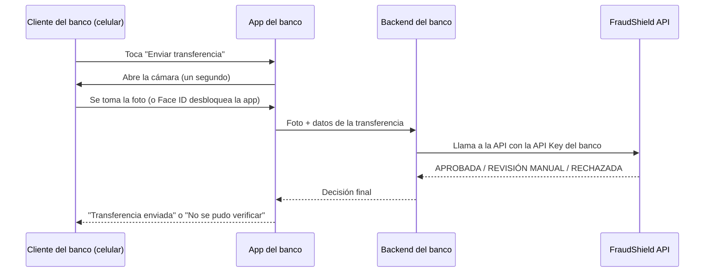

# Guía de Integración — FraudShield

**Para quién es este documento:** el equipo técnico (desarrolladores,
arquitectos) de un banco o institución financiera que quiere conectar
su propia app o sistema con FraudShield para verificar identidad y
riesgo de fraude antes de aprobar una transferencia.

**Qué vas a encontrar aquí:** exactamente en qué momento de tu flujo de
transferencia debes llamar a nuestra API, cómo autenticarte, qué
respuestas esperar, y cómo manejar cada caso — con ejemplos de código
listos para copiar y adaptar.

No hace falta ser experto en FraudShield para seguir esta guía — está
escrita para que cualquier desarrollador la entienda sin haber visto el
proyecto antes.

---

## 1. La idea en una sola imagen

FraudShield NO es una app que tus clientes abren por separado. Es un
servicio que **tu propia app del banco** llama por detrás, en el
momento justo, para preguntar "¿esta persona es quien dice ser, y esta
transacción se ve riesgosa?" — y tu app decide qué hacer con la respuesta.



**El punto más importante de este diagrama:** la app del celular **no
le habla directamente a FraudShield** — le habla a **tu propio
backend**, y es tu backend quien llama a FraudShield. Esto no es un
detalle menor, es una regla de seguridad. Lo explicamos en la sección 3.

---

## 2. Autenticación: ¿cómo le demuestro a FraudShield que soy yo?

Hay dos formas de autenticarse, para dos casos distintos:

| Método | Para quién | Cómo se usa |
|---|---|---|
| **API Key** | Sistemas de un banco/institución (integración servidor-a-servidor) | Header `X-API-Key: <tu-key>` |
| **Token de sesión (JWT)** | Un usuario humano usando la app web de FraudShield directamente | Header `Authorization: Bearer <token>` |

**Si estás integrando la app de tu banco, usas API Key.** El JWT es
para el caso de que alguien use la interfaz web de FraudShield
directamente (poco probable si ya tienes tu propia app).

### 2.1. Cómo conseguir tu API Key

1. Pide al administrador de FraudShield que te cree una desde el panel
   de administración (pestaña "API Keys").
2. Te va a compartir una cadena larga (algo como
   `a1b2c3d4e5f6...`, 64 caracteres) — **esa es tu API Key completa**.
3. **Cópiala y guárdala de inmediato en un lugar seguro** (un gestor de
   secretos, variables de entorno de tu servidor). FraudShield **no
   puede volver a mostrártela** después de este momento — solo guarda
   una huella (hash) de ella, no la key en sí, por seguridad.

---

## 3. ⚠️ Regla de seguridad: la API Key NUNCA va dentro de la app móvil

Este es el error de integración más común y más peligroso, así que lo
explicamos aparte, con calma.

**Lo que NO debes hacer:** poner tu API Key directamente en el código
de la app de Android/iOS, para que la app llame a FraudShield desde el
celular del cliente.

**Por qué es un problema:** cualquier app instalada en un celular se
puede "abrir" (descompilar) con herramientas gratuitas y ver su código
por dentro. Si tu API Key está ahí, cualquiera que descargue tu app
puede extraerla y usarla para hacerse pasar por tu institución ante
FraudShield — gastando tu cuota, o peor, enviando datos falsos a
nombre de tu banco.

**Lo correcto:** la app del banco solo captura la foto y los datos de
la transferencia, y se los manda a **tu propio backend** (el servidor
que tu banco ya tiene, donde procesas las transferencias). Es tu
backend — que corre en un servidor que tú controlas, no en el celular
de un cliente — quien guarda la API Key y llama a FraudShield.

```
❌ Celular del cliente → FraudShield directamente (la API Key quedaría expuesta)
✅ Celular del cliente → Backend de tu banco → FraudShield (la API Key nunca sale de tu servidor)
```

Esto es exactamente lo que muestra el diagrama de la sección 1 — no es
un paso extra innecesario, es la forma segura de hacerlo.

---

## 4. El endpoint principal: evaluar identidad + riesgo juntos

Para el caso más común — verificar a la persona Y evaluar el riesgo de
su transferencia en un solo paso — usa este endpoint:

```
POST /api/v1/transferencia/procesar
```

### 4.1. Qué le mandas

```json
{
  "frame": "data:image/jpeg;base64,/9j/4AAQSkZJRg...",
  "user_id": 12345,
  "monto": 15000.00,
  "cuenta_destino": "1234567890",
  "llamada_activa": false,
  "tiempo_desde_deposito_minutos": 340.5,
  "datos_copiados": false,
  "latitud": 18.4861,
  "longitud": -69.9312
}
```

| Campo | Qué es | Obligatorio |
|---|---|---|
| `frame` | La foto de la persona, en base64 | Sí |
| `user_id` | El ID con el que esa persona está registrada en FraudShield | Sí |
| `monto` | Monto de la transferencia | Sí |
| `cuenta_destino` | Cuenta a la que se envía el dinero | Sí |
| `llamada_activa` | Si el celular detecta una llamada telefónica activa en este momento (señal de posible fraude por ingeniería social) | Sí |
| `tiempo_desde_deposito_minutos` | Cuánto tiempo pasó desde que esos fondos entraron a la cuenta origen | Sí |
| `datos_copiados` | Si los datos del destinatario se pegaron de golpe en vez de escribirse a mano (señal de que alguien se los dictó) | No (default: `false`) |
| `latitud` / `longitud` | Ubicación del dispositivo al momento de la transferencia | No — si el usuario negó el permiso de ubicación, simplemente no los mandes |

### 4.2. Qué te responde

```json
{
  "veredicto": "APROBADA",
  "motivo_principal": "Identidad verificada y transacción sin señales de riesgo",
  "identidad": {
    "resultado": "APROBADO",
    "score": 94,
    "coincidencia": true,
    "similitud": 0.891,
    "deepfake": false,
    "confianza_antispoof": 0.97
  },
  "riesgo_transaccion": {
    "status": "APROBADA",
    "risk_score": 0,
    "alertar_usuario": false,
    "motivos": []
  }
}
```

El campo que más te importa es `"veredicto"` — puede ser:

| Veredicto | Qué significa | Qué debe hacer tu app |
|---|---|---|
| `APROBADA` | Identidad confirmada y transacción sin señales de riesgo | Procesa la transferencia normalmente |
| `REVISION_MANUAL` | Ninguna señal clara de fraude, pero tampoco 100% de certeza | Retén la transferencia y muéstrale al cliente un mensaje de "estamos verificando tu transacción" — un analista del banco debe revisarla (ver sección 7) |
| `RECHAZADA` | Se detectó fraude de identidad o de comportamiento | No proceses la transferencia — muéstrale al cliente un mensaje claro (sin revelar detalles técnicos que pudieran ayudar a un atacante) |

---

## 5. Otros dos endpoints, para casos más específicos

Si no necesitas el flujo combinado completo, hay dos endpoints más
simples:

### 5.1. Solo evaluar el riesgo de una transacción (sin biometría)

Útil si tu banco ya maneja la verificación de identidad por su cuenta
(por ejemplo, con Face ID nativo del celular para desbloquear la app) y
solo quieres el análisis de riesgo de FraudShield.

```
POST /api/v1/transacciones/evaluar
```

```json
{
  "cliente_id": 12345,
  "monto": 15000.00,
  "cuenta_destino": "1234567890",
  "llamada_activa": false,
  "tiempo_desde_deposito_minutos": 340.5,
  "datos_copiados": false
}
```

Responde con `"status"`: `"APROBADA"` o `"RECHAZADA"`, más el detalle
del riesgo (`risk_score`, `motivos`).

> **Nota importante sobre Face ID / biometría nativa del celular:** si
> tu banco usa Face ID o el sensor de huella del celular para
> desbloquear la app, eso confirma "quien tiene este celular puede
> desbloquearlo" — pero NO confirma que esa persona sea el cliente
> específico que tu banco tiene registrado (alguien pudo configurar su
> propia huella en un celular robado). Si necesitas ese nivel de
> certeza (recomendado para transferencias grandes), usa el endpoint
> combinado de la sección 4, que sí compara contra el rostro
> específicamente registrado por ese cliente.

### 5.2. Solo verificar identidad (sin evaluar una transacción)

Útil para, por ejemplo, verificar identidad al iniciar sesión, sin que
haya una transferencia de por medio todavía.

```
POST /api/v1/biometria/verificar
```

Requiere un token de sesión (JWT) de ese usuario, no una API Key — está
pensado para cuando el usuario ya inició sesión en la app de FraudShield
directamente. Para integraciones de banco, normalmente usarás el
endpoint combinado de la sección 4 en su lugar.

---

## 6. Ejemplos de código

### 6.1. cURL (para probar rápido desde la terminal)

```bash
curl -X POST https://tu-servidor-fraudshield.com/api/v1/transferencia/procesar \
  -H "X-API-Key: TU_API_KEY_AQUI" \
  -H "Content-Type: application/json" \
  -d '{
    "frame": "data:image/jpeg;base64,...",
    "user_id": 12345,
    "monto": 15000.00,
    "cuenta_destino": "1234567890",
    "llamada_activa": false,
    "tiempo_desde_deposito_minutos": 340.5
  }'
```

### 6.2. Python (backend del banco)

```python
import requests

def verificar_transferencia(foto_base64, user_id, monto, cuenta_destino):
    respuesta = requests.post(
        "https://tu-servidor-fraudshield.com/api/v1/transferencia/procesar",
        headers={"X-API-Key": "TU_API_KEY_AQUI"},
        json={
            "frame": foto_base64,
            "user_id": user_id,
            "monto": monto,
            "cuenta_destino": cuenta_destino,
            "llamada_activa": False,
            "tiempo_desde_deposito_minutos": 340.5,
        },
        timeout=15,  # dale tiempo suficiente — el análisis facial puede tardar unos segundos
    )
    respuesta.raise_for_status()
    return respuesta.json()

resultado = verificar_transferencia(foto, 12345, 15000.00, "1234567890")

if resultado["veredicto"] == "APROBADA":
    procesar_transferencia_normalmente()
elif resultado["veredicto"] == "REVISION_MANUAL":
    retener_para_revision_humana(resultado)
else:  # RECHAZADA
    bloquear_transferencia(resultado["motivo_principal"])
```

### 6.3. Node.js / JavaScript (backend del banco)

```javascript
async function verificarTransferencia(fotoBase64, userId, monto, cuentaDestino) {
  const respuesta = await fetch(
    "https://tu-servidor-fraudshield.com/api/v1/transferencia/procesar",
    {
      method: "POST",
      headers: {
        "X-API-Key": "TU_API_KEY_AQUI",
        "Content-Type": "application/json",
      },
      body: JSON.stringify({
        frame: fotoBase64,
        user_id: userId,
        monto: monto,
        cuenta_destino: cuentaDestino,
        llamada_activa: false,
        tiempo_desde_deposito_minutos: 340.5,
      }),
    }
  );

  if (!respuesta.ok) {
    throw new Error(`FraudShield respondió ${respuesta.status}`);
  }

  return await respuesta.json();
}
```

### 6.4. Del lado del celular: solo capturar la foto

La app móvil (iOS/Android) solo necesita:
1. Pedir permiso de cámara al sistema operativo (`AVCaptureSession` en
   iOS, `CameraX` en Android, o el equivalente en tu framework — React
   Native, Flutter, etc.).
2. Tomar una foto y convertirla a base64.
3. Mandarla a **tu propio backend** (nunca directo a FraudShield) junto
   con los datos de la transferencia.

Ese es literalmente todo lo que la app necesita saber sobre
FraudShield — el resto de la lógica (llamar a la API, interpretar la
respuesta) vive en tu backend.

---

## 7. ¿Qué hago con un veredicto de REVISIÓN MANUAL?

Cuando FraudShield devuelve `"REVISION_MANUAL"`, significa que ni la
identidad ni el riesgo dieron una señal 100% clara en ningún sentido —
ni para aprobar con confianza, ni para rechazar con confianza.

Recomendación:
1. Retén la transferencia (no la proceses todavía).
2. Muéstrale al cliente un mensaje como "Tu transferencia está en
   revisión, te notificaremos en breve" — evita alarmar al cliente
   diciéndole que hay una sospecha de fraude, ya que la mayoría de
   estos casos terminan siendo legítimos.
3. Un analista de tu banco revisa el caso desde el panel de
   administración de FraudShield (pestaña "Revisar verificaciones") y
   decide si aprobar o rechazar.
4. Notifica al cliente el resultado final.

---

## 8. Manejo de errores

| Código HTTP | Qué significa | Qué hacer |
|---|---|---|
| `200` | Todo bien — revisa el campo `veredicto`/`status` en la respuesta | Procesa normalmente |
| `400` | Los datos que mandaste tienen un problema (ej. imagen inválida) | Revisa el campo `detalle` de la respuesta y corrige la petición |
| `401` | Tu API Key no es válida, o falta | Verifica que estás mandando el header `X-API-Key` correctamente |
| `403` | Tu API Key es válida pero no tiene permiso para esto | Contacta al administrador de FraudShield |
| `429` | Superaste tu cuota de peticiones por segundo (ver sección 9) | Espera un momento y reintenta; si esto pasa seguido, pide que te suban la cuota |
| `500` | Error interno de FraudShield | Reintenta una vez; si persiste, contacta soporte |

**Sobre timeouts:** el análisis facial puede tardar unos segundos en
máquinas sin GPU dedicada. Configura tu cliente HTTP con un timeout de
al menos 15-20 segundos para este endpoint — un timeout muy corto
podría cortar la petición antes de que FraudShield termine de responder.

---

## 9. Límite de peticiones (rate limiting)

Cada institución tiene su propia cuota de peticiones por segundo,
configurada en su API Key — así ninguna integración puede saturar el
sistema a costa de las demás que también lo usan.

Si superas tu cuota, recibes un `429` con este formato:

```json
{
  "error": "Límite de peticiones excedido",
  "detalle": "Esta institución/usuario superó su cuota de peticiones por segundo...",
  "limite": "..."
}
```

**Si tu volumen de transacciones va a crecer** (por ejemplo, vas a
lanzar una campaña que aumentará las transferencias), avisa con
anticipación para que el administrador de FraudShield ajuste tu límite
desde el panel — no hace falta ningún cambio de código de tu parte,
solo coordinación previa.

---

## 10. Ambiente de pruebas

Antes de integrar contra el ambiente de producción, pide al
administrador de FraudShield una API Key de pruebas (marcada como tal
en el panel), y usa usuarios de prueba ya registrados con fotos de
ejemplo — así puedes probar los 3 veredictos posibles (`APROBADA`,
`REVISION_MANUAL`, `RECHAZADA`) sin arriesgar datos reales de clientes.

---

## 11. Buenas prácticas de seguridad (resumen)

- ✅ La API Key vive SOLO en tu backend, nunca en la app móvil (sección 3).
- ✅ Todas las llamadas a FraudShield van por HTTPS — nunca por HTTP simple.
- ✅ Si sospechas que una API Key se filtró, pide que la revoquen de
  inmediato desde el panel de administración y que te generen una nueva.
- ✅ No reutilices la misma API Key para ambientes distintos (pruebas y
  producción deben tener keys separadas).
- ✅ Guarda tu API Key en un gestor de secretos de tu infraestructura
  (Azure Key Vault, AWS Secrets Manager, variables de entorno cifradas),
  no en el código fuente ni en un repositorio de Git.

---

## 12. Preguntas frecuentes

**¿Puedo llamar a FraudShield directamente desde el navegador web de mi
banca en línea (no una app móvil)?**
Misma regla que con el celular: el navegador del cliente no debería
tener la API Key. Tu backend de banca en línea debe hacer la llamada.

**¿Qué pasa si el cliente niega el permiso de cámara?**
Sin foto no se puede verificar identidad — tu app debería explicarle al
cliente que la verificación facial es necesaria para transferencias, y
ofrecerle un canal alternativo (sucursal, línea telefónica) si insiste
en no dar el permiso.

**¿Qué pasa si el cliente no tiene el rostro registrado en FraudShield
todavía?**
Necesita completar el registro (4 fotos desde distintos ángulos) antes
de poder verificarse. Esto normalmente pasa una sola vez, al activar la
banca digital.

**¿Cuánto tarda una llamada al endpoint combinado?**
Depende del hardware donde corra FraudShield — sin GPU dedicada, unos
2-5 segundos es razonable. Con GPU, puede ser bastante más rápido.

---

## 13. Soporte

Para dudas técnicas de integración, problemas con tu API Key, o
solicitudes de aumento de cuota, contacta al equipo de FraudShield a
través de los canales que te haya compartido tu administrador.
